# Waypost – felhasználói kézikönyv

*Őröknek és supervisoroknak · Android és iOS · 1. lépcső*

A Waypost a járőrözés ellenőrzésére szolgál. Az őr a telephelyen hagyott telefonnal bejárja a kijelölt pontokat, és mindegyiknél leolvassa a címkét (NFC vagy QR). A telefon jelzi, mikor indul a következő kör, és rögzíti, mikor, melyik pontot, milyen módon olvasták le. A supervisor a saját telefonján állítja be a telephelyeket, az útvonalakat, a menetrendet és az őrök PIN-kódját, a jelentéseket pedig e-mailben kapja.

A képernyőképek egy 6,2 hüvelykes Android-telefonon készültek, a próbaszerver adataival („E2E Raktár”, „Minta Raktár”, „Éjszakai kör”). A PIN-kódokat a képeken eltakartuk.

## Tartalom

1. [Alapok](#1-alapok)
2. [Supervisor](#2-supervisor)
   - [Belépés és telephelyek](#21-belépés-és-telephelyek)
   - [Új telephely](#22-új-telephely)
   - [A telephely oldala](#23-a-telephely-oldala)
   - [Őrök és PIN-kódok](#24-őrök-és-pin-kódok)
   - [Útvonal betanítása](#25-útvonal-betanítása)
   - [Útvonal szerkesztése, QR-címke](#26-útvonal-szerkesztése-qr-címke)
   - [Menetrend](#27-menetrend)
   - [Jelentések](#28-jelentések)
   - [A telephelyi telefon hozzárendelése](#29-a-telephelyi-telefon-hozzárendelése)
   - [Telefon beállítása](#210-telefon-beállítása)
   - [Supervisor mód a telephelyi telefonon](#211-supervisor-mód-a-telephelyi-telefonon)
3. [Őr](#3-őr)
   - [Belépés PIN-kóddal](#31-belépés-pin-kóddal)
   - [Műszakkezdés](#32-műszakkezdés)
   - [A kezdőlap](#33-a-kezdőlap)
   - [Ébresztés](#34-ébresztés)
   - [A kör](#35-a-kör)
   - [Mit jelez a telefon leolvasáskor?](#36-mit-jelez-a-telefon-leolvasáskor)
   - [Kézi rögzítés: ha a címke nem olvasható](#37-kézi-rögzítés-ha-a-címke-nem-olvasható)
   - [Esemény rögzítése](#38-esemény-rögzítése)
   - [Műszakzárás](#39-műszakzárás)
4. [Gyakori kérdések, hibaelhárítás](#4-gyakori-kérdések-hibaelhárítás)

---

## 1. Alapok

### Szerepek

| Szerep | Telefon | Belépés | Mit csinál |
| --- | --- | --- | --- |
| **Őr** | a telephelyi telefon | 6 jegyű PIN-kód | műszakot kezd és zár, köröket jár, eseményt rögzít |
| **Supervisor** | a saját telefonja | e-mail-cím és jelszó | telephelyek, útvonalak, menetrend, őrök, jelentések |
| **Supervisor** a telephelyen | a telephelyi telefon | a saját PIN-kódja | ugyanaz, mint a saját telefonján (pl. betanítás a helyszínen) |

### Kétféle telefon

- **A telephelyi telefon** a telephelyen marad, a műszakok során több őr használja. Minden telephelynek egy telephelyi telefonja van, amelyet a supervisor rendel hozzá (lásd: [2.9](#29-a-telephelyi-telefon-hozzárendelése)). Ezen csak PIN-kóddal lehet belépni.
- **A supervisor saját telefonja** a supervisornál van. A fiókjával (e-mail-cím és jelszó) lép be rajta, és innen kezeli a telephelyeit.

### Internet nélkül is működik

Minden rögzítés (leolvasás, esemény, fotó, műszakzárás, a supervisor módosításai) először a telefonra kerül, a szerverre pedig akkor töltődik fel, amikor van kapcsolat. A képernyők jobb felső sarkában álló **szinkronjelző** mutatja az állapotot:

| Felirat | Jelentés |
| --- | --- |
| **Szinkronizálva** (zöld) | minden fent van a szerveren |
| **Online · 3 vár** / **Feltöltés… 3** | a telefon éppen feltölt |
| **Offline · 3 vár** | nincs internet; minden működik tovább, a tételek később felkerülnek |
| **Szinkronhiba · újra** | a feltöltés nem sikerült, a telefon magától újrapróbálja |

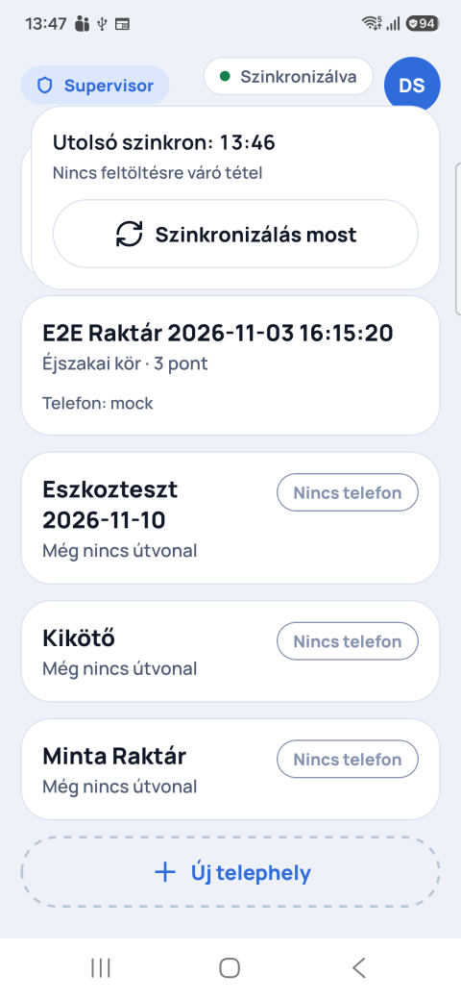

A jelzőre koppintva megnyílnak a részletek: mikor volt az utolsó szinkron, hány tétel vár feltöltésre. Itt a **Szinkronizálás most** gombbal azonnal elindítható a feltöltés.

> **Fontos:** a telefonon rögzített adat a feltöltés előtt nem módosul és nem törlődik. Ha a telefon napokig nem kap internetet, akkor sem vész el semmi.

---

## 2. Supervisor

### 2.1 Belépés és telephelyek

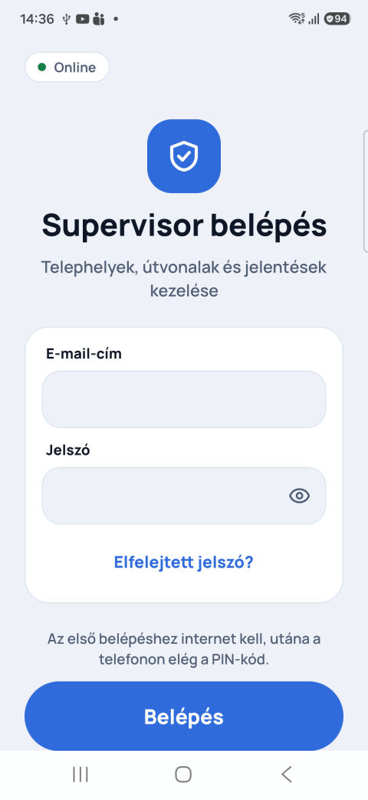
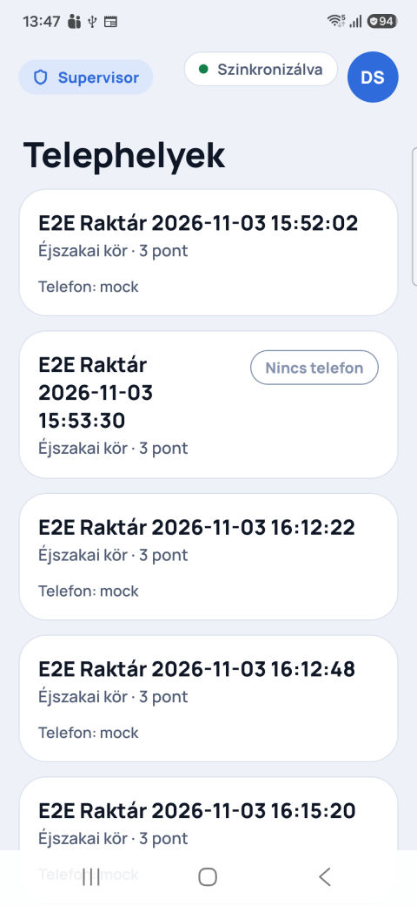
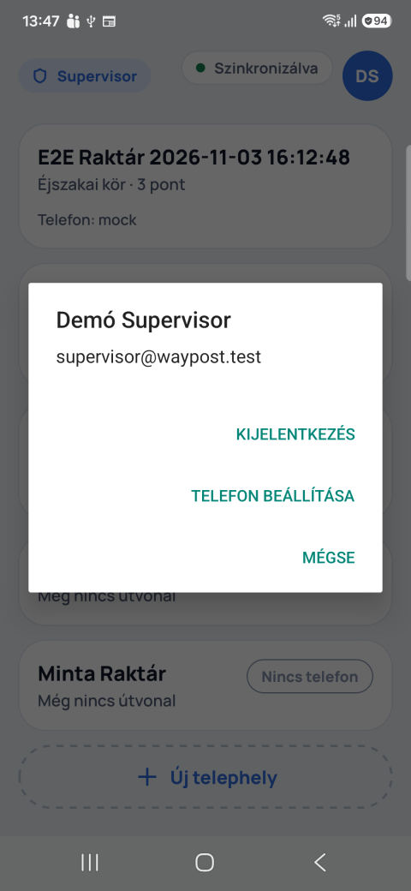

1. A saját telefonodon nyisd meg a Waypostot, add meg az **e-mail-címedet** és a **jelszavadat**, majd koppints a **Belépés** gombra. Az első belépéshez internet kell.
2. A **Telephelyek** listában minden telephelyed szerepel, mellette az útvonal, a pontok száma és a telephelyi telefon neve.
3. A jobb felső sarokban lévő fiók gomb nyitja a **fiókmenüt**:
   - **Telefon beállítása**: az engedélyek ellenőrzőlistája, a megjelenés (világos, sötét, rendszer) és a hibanapló.
   - **Kijelentkezés**: ha van még fel nem küldött módosításod, az app előbb figyelmeztet, mert kijelentkezéskor ezek elvesznek.

Ha elfelejtetted a jelszavadat, a Waypost üzemeltetője tud újat beállítani.

### 2.2 Új telephely

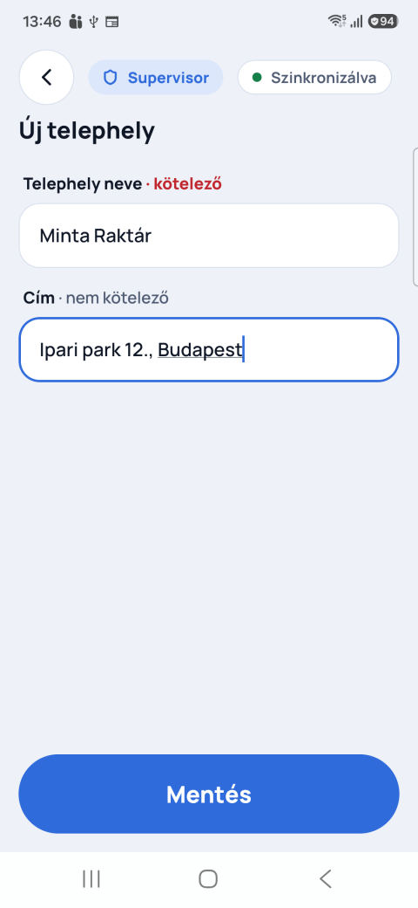
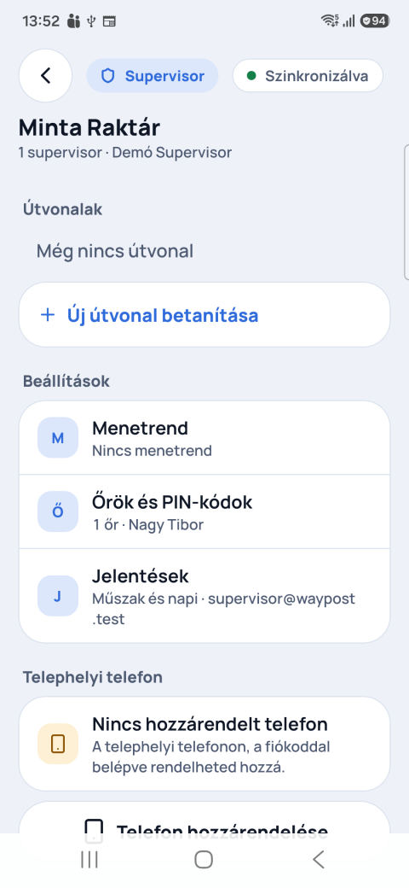

A Telephelyek képernyőn koppints az **Új telephely** gombra, add meg a **nevet** (kötelező) és a **címet**, majd mentsd el.

> **Példa:** Név: *Minta Raktár*, cím: *Ipari park 12., Budapest*.

Az új telephely még üres. A következő lépések:

1. az őrök felvétele ([2.4](#24-őrök-és-pin-kódok)),
2. az útvonal betanítása ([2.5](#25-útvonal-betanítása)),
3. a menetrend megadása ([2.7](#27-menetrend)),
4. a jelentések kiválasztása ([2.8](#28-jelentések)),
5. a telephelyi telefon hozzárendelése ([2.9](#29-a-telephelyi-telefon-hozzárendelése)).

Offline is menthető, a telephely a kapcsolat visszatérésekor kerül fel.

### 2.3 A telephely oldala

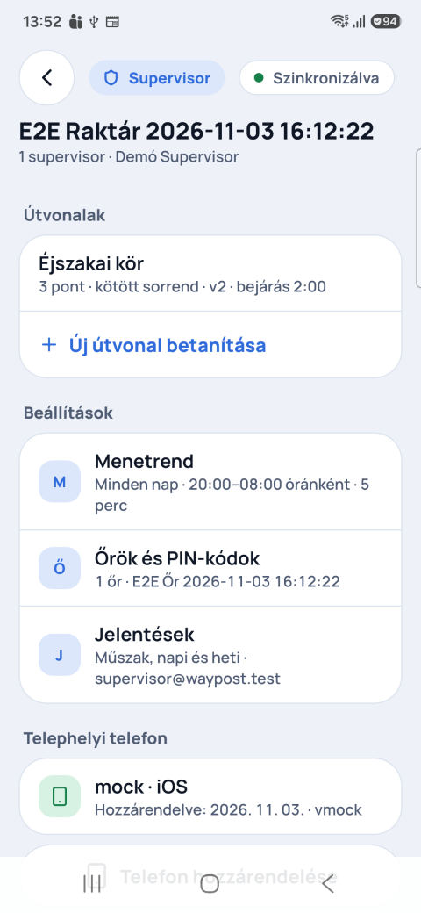

A telephely oldalán minden beállítás egy helyen van:

- **Útvonalak**: az útvonal neve, a pontok száma, a sorrend (kötött vagy szabad), a verzió és a bejárás mért ideje. Példa: *Éjszakai kör · 3 pont · kötött sorrend · v2 · bejárás 2:00*. Új útvonalat az **Új útvonal betanítása** gombbal veszel fel.
- **Menetrend**: összefoglaló, pl. *Minden nap · 20:00–08:00 óránként · 5 perc*.
- **Őrök és PIN-kódok**: hány őr van, és kik.
- **Jelentések**: mit kapsz e-mailben, és hova.
- **Telephelyi telefon**: melyik telefon van hozzárendelve, mikor szinkronizált utoljára, és hány tétel vár rajta.

### 2.4 Őrök és PIN-kódok

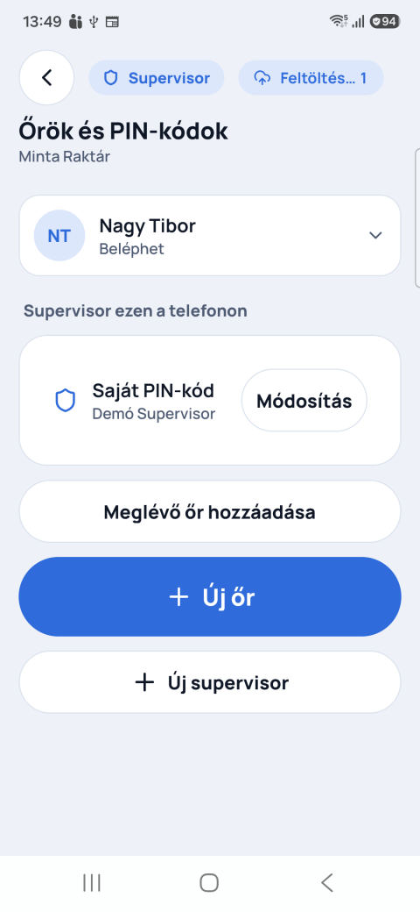
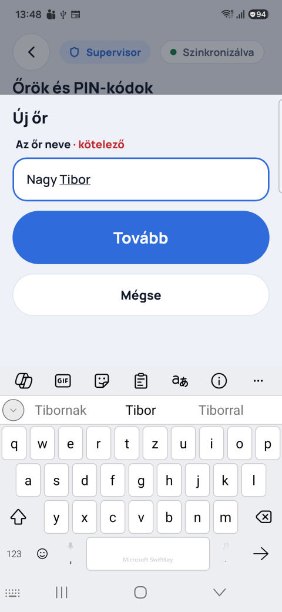
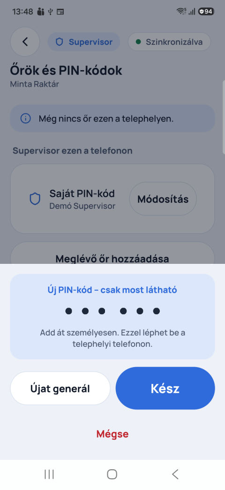

**Új őr felvétele**

1. Az **Őrök és PIN-kódok** képernyőn koppints az **Új őr** gombra.
2. Add meg az őr nevét (pl. *Nagy Tibor*), majd koppints a **Tovább** gombra.
3. Az app generál egy 6 jegyű PIN-kódot. **Ez csak most látható**, utána sehol nem lehet visszanézni. Ha nem tetszik (pl. túl könnyen megjegyezhető), koppints az **Újat generál** gombra.
4. Add át a kódot az őrnek személyesen, majd koppints a **Kész** gombra.

A PIN-kódot nem lehet kézzel megadni, mindig az app generálja. Ha két embernek véletlenül ugyanaz lenne a kódja ugyanazon a telephelyen, a szerver ezt elutasítja, és az app új kód generálását kéri.

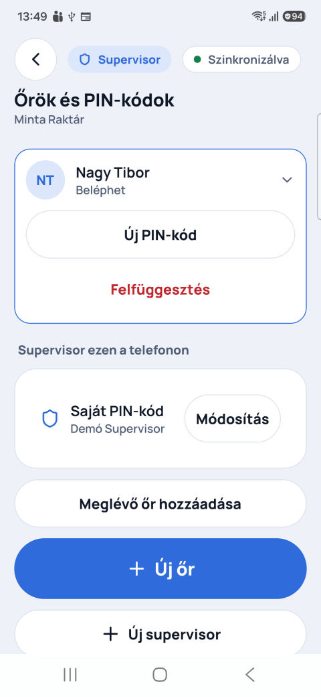
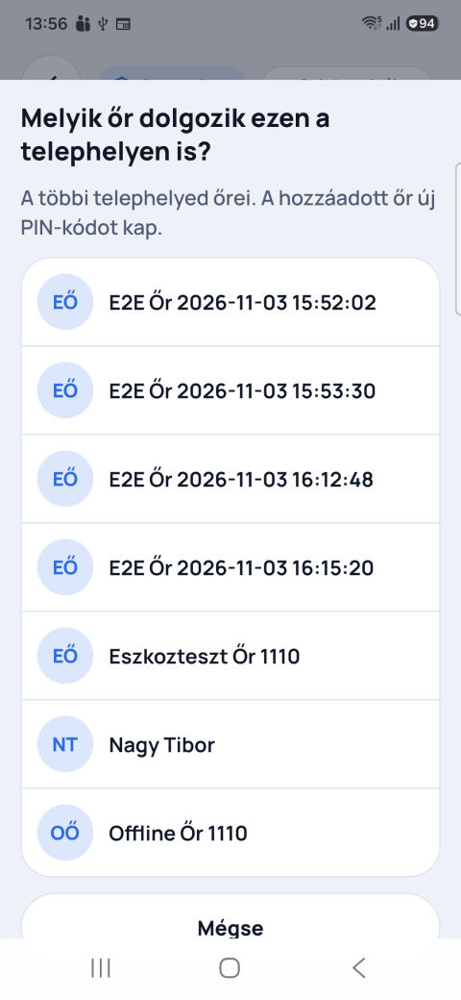
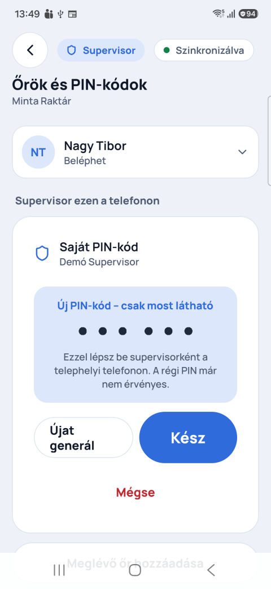

**Egy őr műveletei** (koppints az őr sorára):

- **Új PIN-kód**: például ha az őr elfelejtette a régit, vagy más is megtudta. A régi kód azonnal érvényét veszti.
- **Felfüggesztés**: az őr nem tud belépni, amíg vissza nem kapcsolod. A PIN-kódja megmarad.

**Meglévő őr hozzáadása:** ha egy őröd másik telephelyen is dolgozik, nem kell újra felvenned. A **Meglévő őr hozzáadása** gomb a többi telephelyed őreit listázza. A hozzáadott őr új PIN-kódot kap, és ez lesz az érvényes kódja az összes telephelyén.

**Saját PIN-kód:** a **Supervisor ezen a telefonon** szakaszban a **Módosítás** gombbal generálhatsz magadnak PIN-kódot. Ezzel lépsz be supervisorként a telephelyi telefonon (lásd: [2.11](#211-supervisor-mód-a-telephelyi-telefonon)).

**Új supervisor:** ugyanitt felvehetsz másik supervisort is (név, e-mail-cím, legalább 8 karakteres jelszó). A saját telefonján az e-mail-címével és a jelszavával lép be, a telephelyi telefonon a kapott PIN-kóddal.

### 2.5 Útvonal betanítása

Az útvonalat a helyszínen, a pontok tényleges bejárásával veszed fel. A betanításhoz NFC-s telefon kell, mert új pontot csak NFC-címkével lehet felvenni. QR-kóddal csak a telephely már meglévő pontjai adhatók hozzá.

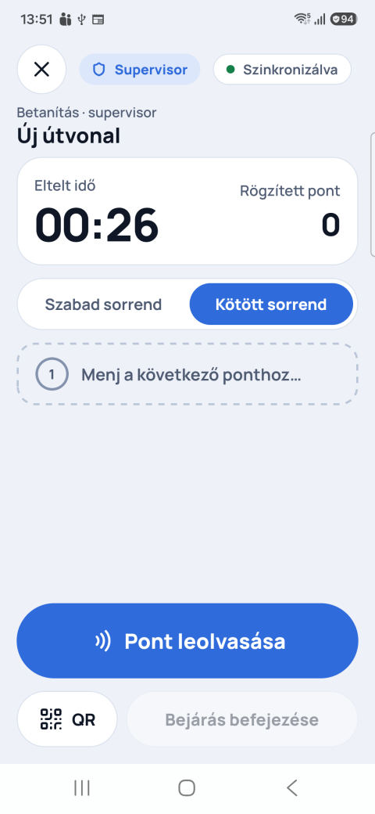
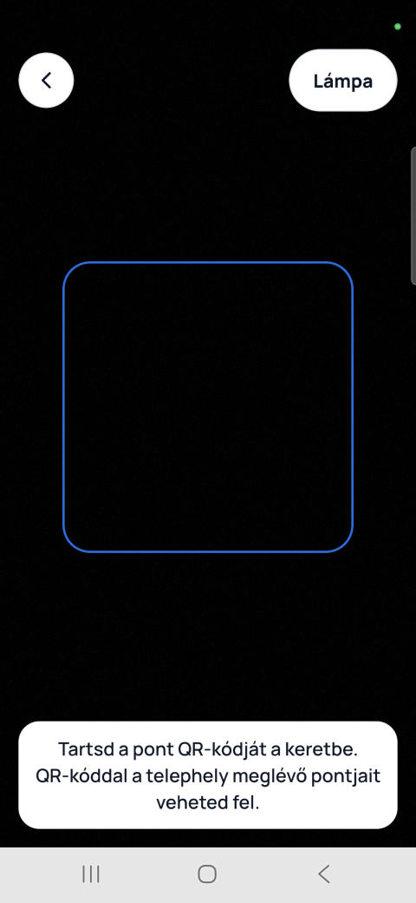
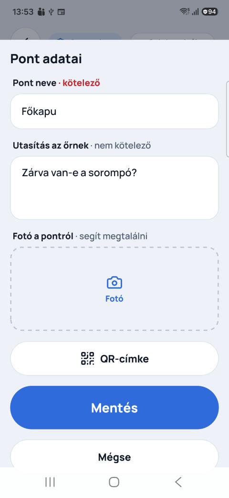

1. A telephely oldalán koppints az **Új útvonal betanítása** gombra. Az **Eltelt idő** innen mér.
2. Válaszd ki a sorrendet:
   - **Kötött sorrend**: az őrnek a megadott sorrendben kell leolvasnia a pontokat. Ha eltér, a telefon figyelmezteti, és ez a jelentésben is látszik.
   - **Szabad sorrend**: a pontok bármilyen sorrendben leolvashatók.
3. Menj az első ponthoz, és érintsd a telefon hátát a címkéhez. Amíg a képernyő nyitva van, gomb nélkül is olvas; a **Pont leolvasása** gomb az NFC-t is bekapcsolja, ha ki van kapcsolva.
4. Töltsd ki a pont adatait:
   - **Pont neve** (kötelező), pl. *Főkapu*.
   - **Utasítás az őrnek**, pl. *Ellenőrizd, hogy a sorompó le van-e zárva.*
   - **Fotó a pontról**, hogy az őr könnyebben megtalálja.
5. A **Mentés, jöhet a következő** gombbal folytasd a következő ponttal.
6. Az utolsó pont után koppints a **Bejárás befejezése** gombra, add meg az útvonal nevét (pl. *Éjszakai kör*), majd koppints a **Mentés új verzióként** gombra.

A befejezéskor az app **időkeretet javasol**: a mért bejárási idő másfélszeresét, 5 percre felfelé kerekítve. Ezt a menetrendnél lehet módosítani.

> **Példák a javasolt időkeretre:**
> - 2 perc bejárás × 1,5 = 3 perc → **5 perc**
> - 12 perc bejárás × 1,5 = 18 perc → **20 perc**
> - 24 perc bejárás × 1,5 = 36 perc → **40 perc**

Ha a betanítást a bal felső **×** gombbal megszakítod, a rögzített pontok elvesznek; az app előbb rákérdez.

### 2.6 Útvonal szerkesztése, QR-címke

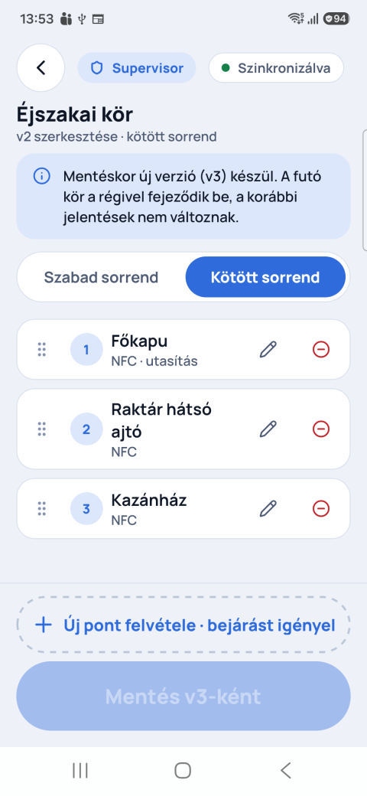
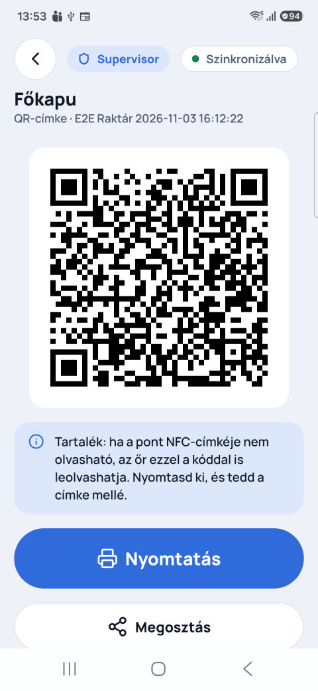

A telephely oldalán koppints az útvonalra. Itt bejárás nélkül módosíthatod:

- **a sorrendet**: a pontot hosszan nyomva húzd a helyére, vagy használd a **Feljebb** és a **Lejjebb** gombot;
- **a pont adatait**: név, utasítás, fotó;
- **a pontok listáját**: egy pont kivehető az útvonalból, a telephelyen akkor is megmarad. Az **Új pont felvétele** viszont bejárást igényel.

Mentéskor **új verzió** készül (pl. v2 → v3). A futó kör még a régi verzióval fejeződik be, a korábbi jelentések nem változnak. Ha közben valaki más is mentett egy új verziót, a módosításaidat újra kell kezdened az új verzióból.

**QR-címke:** a pont adatainál a QR-kód képe is megnyitható. **Nyomtatással** vagy **Megosztással** (pl. e-mailben a nyomtatónak) papírra kerül.

- NFC-s pontnál a QR-kód **tartalék**: ha az NFC-címke megsérül, az őr a mellé ragasztott QR-kódot olvassa le.
- QR-pontnál a QR-kód maga a pont címkéje: ezt kell kitenni a pont helyére.

### 2.7 Menetrend

A menetrend mondja meg, mikor indulnak a körök. A telephelyi telefon ezekre az időpontokra ébreszti az őrt.

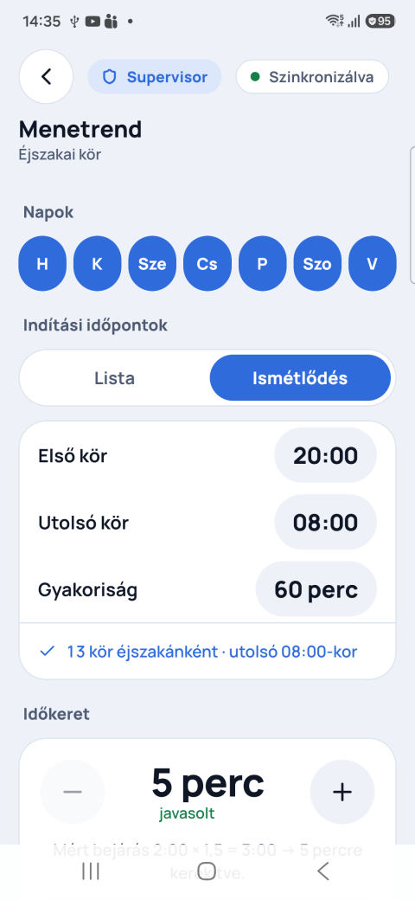
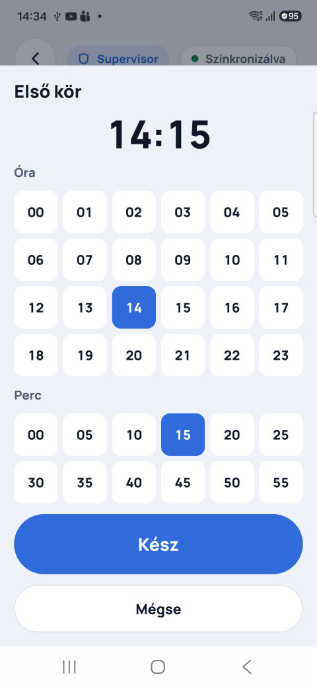
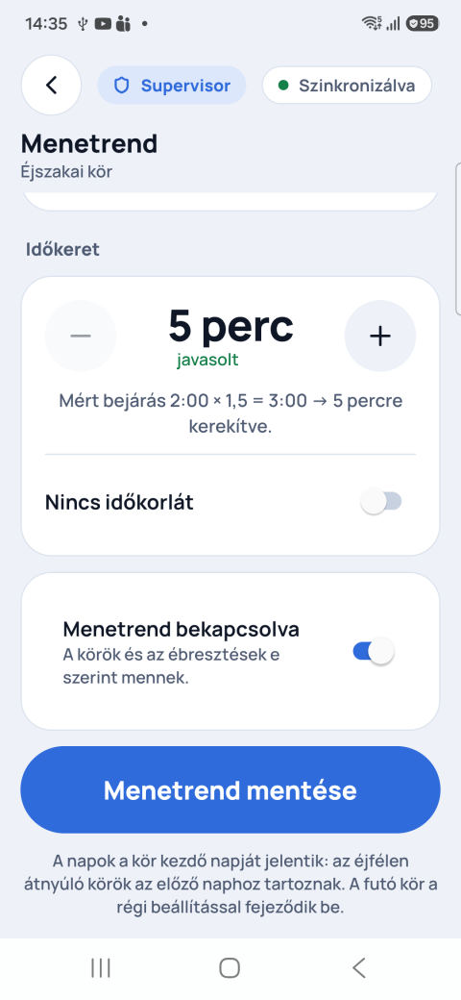

1. **Napok**: jelöld ki, mely napokon legyenek körök. A nap mindig a kör **kezdő napját** jelenti: az éjfélen átnyúló körök az előző naphoz tartoznak.
2. **Indítási időpontok**, kétféleképpen:
   - **Ismétlődés**: első kör, utolsó kör, gyakoriság.
   - **Lista**: tetszőleges időpontok egyenként.
3. **Időkeret**: a kör indulási időpontjától ennyi idő van a bejárására; ez adja a kör **határidejét**. A javasolt érték a betanításkor mért időből jön; a **–** és a **+** gomb 5 percenként módosítja. **Nincs időkorlát** esetén a határidő a következő kör indulása, a nap utolsó köre után pedig 60 perc.
4. **Menetrend bekapcsolva**: kikapcsolva nincs kör és ébresztés, de a beállítások megmaradnak (pl. szabadság vagy leállás idejére).
5. Koppints a **Menetrend mentése** gombra.

> **1. példa – éjszakai őrzés, óránként:**
> Napok: minden nap · Első kör: 20:00 · Utolsó kör: 08:00 · Gyakoriság: 60 perc
> → *13 kör éjszakánként · utolsó 08:00-kor* (20:00, 21:00, … 07:00, 08:00).
> A hétfő este 20:00-kor kezdődő éjszaka összes köre, a kedd reggel 08:00-s is, a **hétfőhöz** tartozik.
>
> **2. példa – hétvégi nappali őrzés, kötött időpontokkal:**
> Napok: Szo, V · Lista: 08:00, 11:30, 15:00, 18:30 → *4 kör naponta · utolsó 18:30-kor*.

A módosított menetrend a következő körtől érvényes, a futó kör még a régi beállítással fejeződik be.

### 2.8 Jelentések

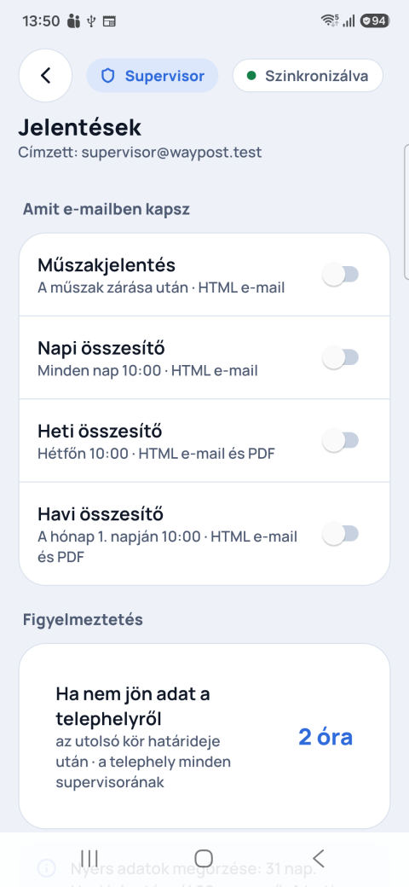
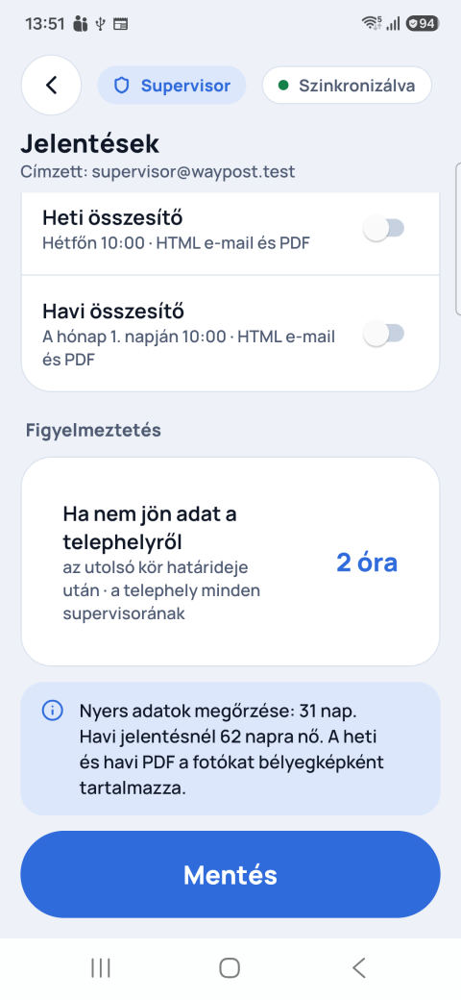

Itt azt állítod be, hogy **te** mit kapsz e-mailben erről a telephelyről. A beállítás a te feliratkozásodra vonatkozik, a többi supervisor maga dönt a sajátjáról.

| Jelentés | Mikor | Formátum |
| --- | --- | --- |
| **Műszakjelentés** | a műszak zárása után | HTML e-mail |
| **Napi összesítő** | minden nap 10:00 | HTML e-mail |
| **Heti összesítő** | hétfőn 10:00 | HTML e-mail és PDF |
| **Havi összesítő** | a hónap 1. napján 10:00 | HTML e-mail és PDF |

A **Figyelmeztetés** a telephely minden supervisorának szól: e-mailt küld, ha az utolsó kör határideje után a beállított ideig (alapértelmezés: 2 óra) nem jön adat a telephelyről. Ilyenkor például lemerült vagy offline van a telephelyi telefon.

**Adatmegőrzés:** a nyers adatok (leolvasások, fotók) 31 napig maradnak meg. Ha a telephelyről havi jelentés is megy, ez 62 napra nő, hogy a havi PDF elkészülhessen. A heti és a havi PDF a fotókat bélyegképként tartalmazza.

### 2.9 A telephelyi telefon hozzárendelése

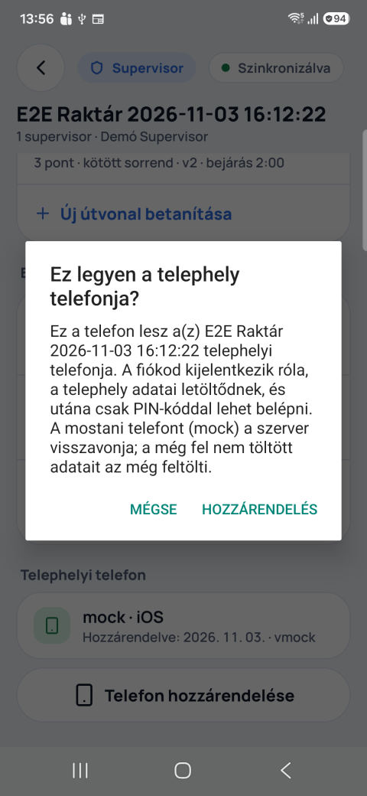

A telephelyi telefont az a telefon rendeli magához, amelyik a telephelyen marad:

1. A **telephelyi telefonon** lépj be a supervisor fiókoddal (e-mail-cím, jelszó). Ehhez internet kell.
2. Nyisd meg a telephelyet, és koppints a **Telefon hozzárendelése** gombra.
3. Erősítsd meg a **Hozzárendelés** gombbal.

A hozzárendeléskor:

- a fiókod kijelentkezik erről a telefonról;
- a telephely adatai letöltődnek;
- utána ezen a telefonon csak PIN-kóddal lehet belépni.

Ha a telephelynek eddig másik telefonja volt, azt a szerver visszavonja. A régi telefon a még fel nem töltött adatait ezután is feltölti, de új rögzítést már nem fogad.

> **Példa – telefoncsere:** a régi telefon kijelzője megrepedt. Az újon lépj be a fiókoddal, és rendeld hozzá a telephelyhez. A régi telefont hagyd bekapcsolva, internettel, amíg a szinkronjelzője nem mutatja, hogy minden felkerült.

Ha a hozzárendelés előtt még van el nem küldött módosításod, előbb azokat kell feltölteni: ellenőrizd a kapcsolatot, és próbáld újra.

### 2.10 Telefon beállítása

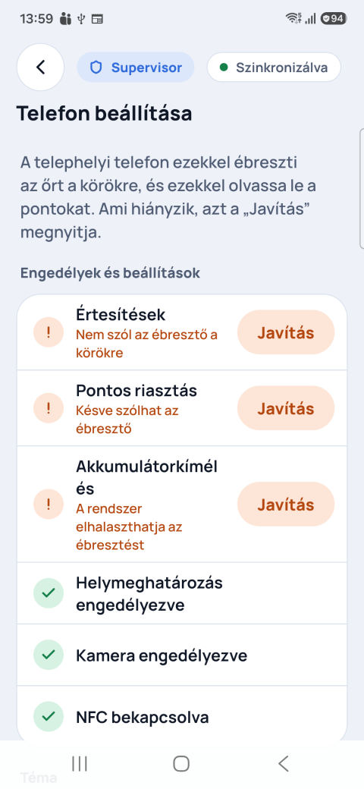
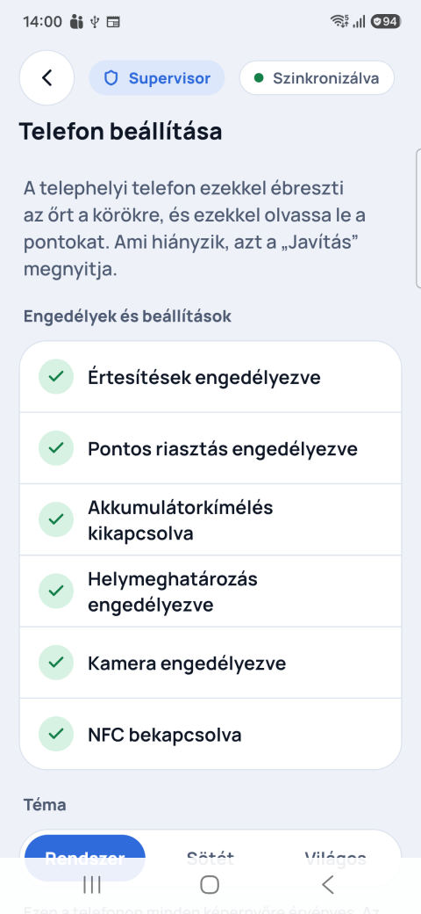
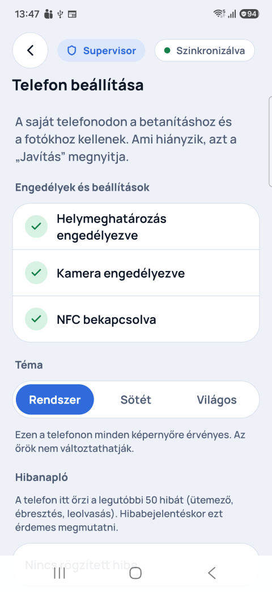

A fiókmenü **Telefon beállítása** pontja ellenőrzőlistát mutat. Ami hiányzik, annál a **Javítás** gomb megnyitja a rendszerbeállítást vagy kéri az engedélyt.

| Beállítás | Miért kell | Ha hiányzik |
| --- | --- | --- |
| **Értesítések** | az ébresztő ezzel szól | nem szól az ébresztő a körökre |
| **Pontos riasztás** (Android) | percre pontos ébresztés | késve szólhat az ébresztő |
| **Akkumulátorkímélés** kikapcsolva (Android) | a rendszer ne altassa el az appot | a rendszer elhalaszthatja az ébresztést |
| **Helymeghatározás** | a leolvasás helyét is rögzíti | a leolvasás helyadat nélkül rögzül |
| **Kamera** | QR-kód, fotók | nem olvasható QR-kód, és nem készülhet fotó |
| **NFC** | a címkék leolvasása | csak QR-kóddal lehet olvasni |

**A telephelyi telefon üzembe helyezésekor minden sor legyen zöld.** A saját telefonodon csak a betanításhoz és a fotókhoz szükséges sorok jelennek meg.

Ugyanitt állítható a **megjelenés** (világos, sötét, a rendszer szerint), és itt látható a **hibanapló** (az utolsó 50 háttérhiba), ha a támogatás kéri.

### 2.11 Supervisor mód a telephelyi telefonon

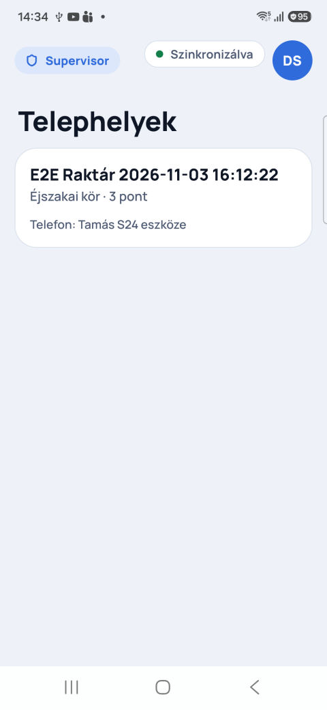
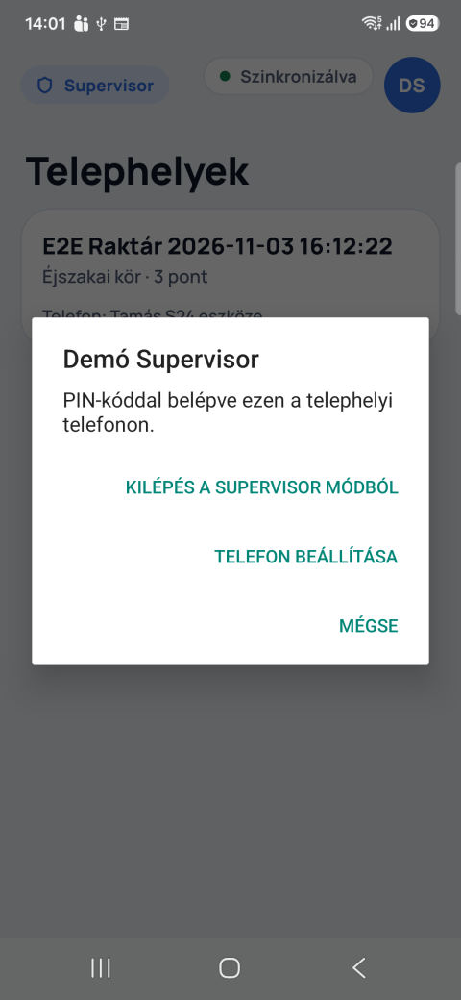

A telephelyi telefonon is dolgozhatsz supervisorként, például ha a helyszínen tanítasz be egy új pontot. A PIN-képernyőn add meg a **saját PIN-kódodat** (lásd: [2.4](#24-őrök-és-pin-kódok)). A kód alapján az app tudja, hogy supervisor vagy, és a supervisor felületet nyitja meg.

A supervisor felületen ugyanazt látod, mint a saját telefonodon, de csak ezt az egy telephelyet. Ha végeztél, a fiókmenüben koppints a **Kilépés a supervisor módból** pontra: a telefon visszatér a PIN-képernyőre.

---

## 3. Őr

### 3.1 Belépés PIN-kóddal

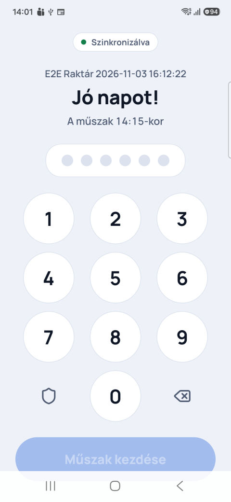
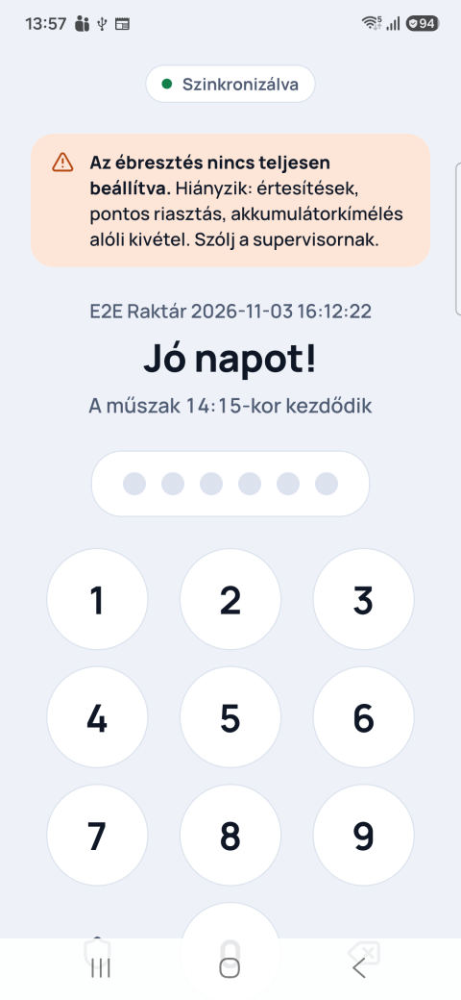
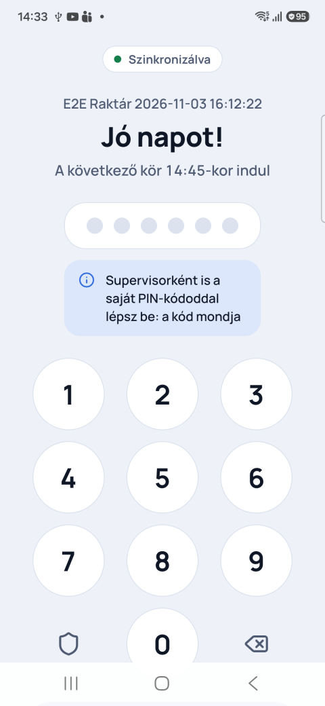

A telephelyi telefon mindig a PIN-képernyővel indul. Felül a köszöntés áll, alatta az, hogy mikor kezdődik a műszak, vagy mikor indul a következő kör.

1. Írd be a **6 jegyű PIN-kódodat**. Elgépelésnél a **Törlés** gombbal javíts.
2. Koppints a **Műszak kezdése** gombra.

**Hibás PIN-kód:** 5 hibás próbálkozás után a telefon 5 percre zárol, és minden további hibás kód után kétszer olyan hosszan (10, 20, 40 perc …). A telefon újraindítása nem rövidíti le a zárolást.

**Sárga figyelmeztetés a képernyő tetején** (*„Az ébresztés nincs teljesen beállítva”*): a telefon valamelyik beállítása hiányzik, ezért lehet, hogy nem szól az ébresztő. **Szólj a supervisornak**, ő a [Telefon beállítása](#210-telefon-beállítása) képernyőn javítja.

A pajzs ikon (**Supervisor mód**) a supervisoroknak szól: megmutatja, hogy ők is a saját PIN-kódjukkal lépnek be.

### 3.2 Műszakkezdés

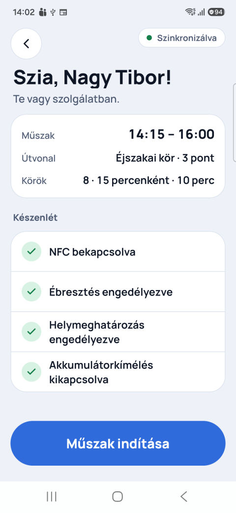

Belépés után az app összefoglalja a műszakot:

- **Műszak**: a műszak kezdete és vége;
- **Útvonal**: pl. *Éjszakai kör · 3 pont*;
- **Körök**: pl. *óránként · 13 időpont · 5 perc*;
- **Készenlét**: NFC, ébresztés, helymeghatározás, akkumulátorkímélés. Ha valamelyik piros, a **Javítás** gombbal rendbe teheted, vagy szólj a supervisornak.

Koppints a **Műszak indítása** gombra.

**Váltás:** ha az előző őr elfelejtette lezárni a műszakját, az app ezt most lezárja, és jelzi: *„Kovács Béla műszakját lezártuk (átadás 06:00). Ez a jelentésben is látszik.”*

### 3.3 A kezdőlap

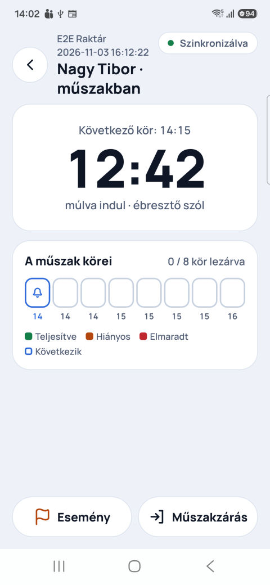
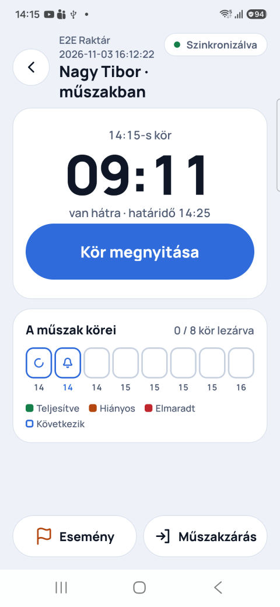
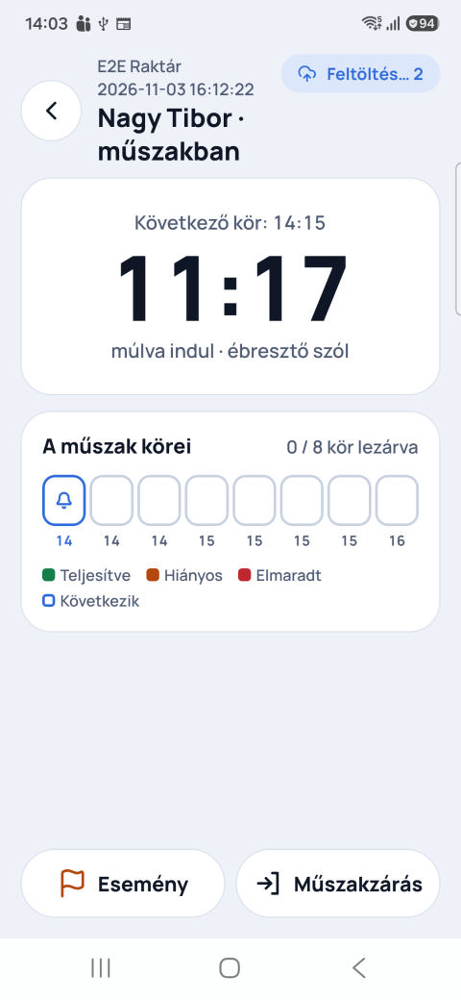

A műszak alatt ez a képernyő látszik:

- **Következő kör**: visszaszámlálás a következő kör indulásáig (*„12:42 múlva indul · ébresztő szól”*). Futó körnél a hátralévő idő és a határidő látszik, alatta a **Kör megnyitása** gomb.
- **A műszak körei**: egy-egy négyzet minden körhöz, alatta az indulás órája.

| Szín | Jelentés |
| --- | --- |
| zöld | **Teljesítve**: a határidőig minden pont megvan (a kézzel rögzített is számít) |
| narancs | **Hiányos**: a határidőig csak néhány pont lett meg |
| piros | **Elmaradt**: a határidőig egy pont sem lett leolvasva |
| kék keret | **Következik** |

Alul két gomb van: **Esemény** ([3.8](#38-esemény-rögzítése)) és **Műszakzárás** ([3.9](#39-műszakzárás)).

A telefont nyugodtan leteheted, és a képernyő kikapcsolhat: az ébresztő akkor is szól.

### 3.4 Ébresztés

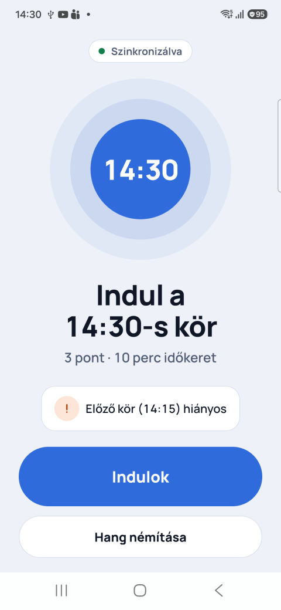

A kör indulásakor a telefon hangosan jelez, és megjelenik az ébresztés képernyője:

- melyik kör indul (pl. *14:15-s kör*), hány pontból áll, és mekkora az időkerete;
- hogyan zárult az előző kör.

Koppints az **Indulok** gombra: megnyílik a kör. A **Hang némítása** csak a hangot kapcsolja ki, a kör ettől még vár rád.

> A **határidő** a menetrend szerinti indulástól számít: a 14:15-s kör 10 perces időkerettel 14:25-ig tart, akkor is, ha csak 14:18-kor indulsz el. Ezért az ébresztés után ne várj. Azt, hogy hány perc alatt jártad be a kört, a telefon az első leolvasástól méri; ez a jelentésben látszik.

Ha a kör nem indul el, a telefon néhány perc múlva emlékeztet. Ha senki nincs belépve, az értesítés a PIN-kód megadására is kér.

### 3.5 A kör

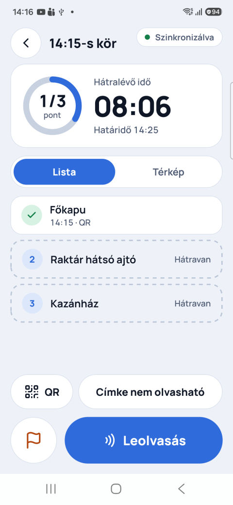
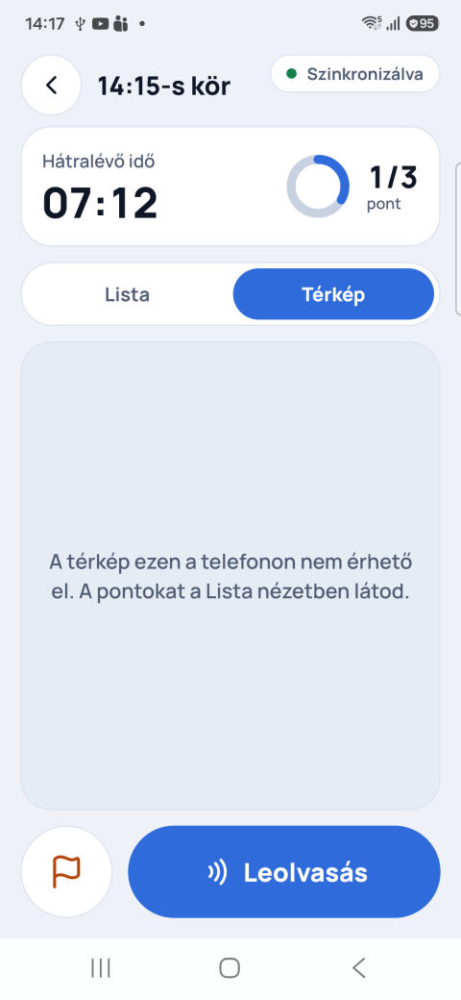

A kör képernyőjén felül a haladás (*1/3 pont*), a **hátralévő idő** és a **határidő** látszik. Alatta a pontok listája:

- ✓ a leolvasott pont, mellette az idő és a módja (pl. *14:15 · QR*);
- szaggatott keret: **hátravan**;
- kötött sorrendnél a sorszám mutatja, melyik pont jön.

**Leolvasás NFC-vel:** menj a ponthoz, és érintsd a telefon **hátát** a címkéhez. Amíg a kör képernyője nyitva van, gomb nélkül is olvas. A **Leolvasás** gomb megmutatja, hova kell érinteni, és ha az NFC ki van kapcsolva, bekapcsolja.

**Leolvasás QR-kóddal:** koppints a **QR** gombra, és tartsd a pont QR-kódját a keretbe.

A **Térkép** fül a pontokat és a megtett utat mutatja, ha a telefonon elérhető a térkép és a pontok helye rögzítve van. Ha nem, a térkép helyén üzenet áll; ilyenkor használd a **Lista** nézetet.

A bal alsó zászló gombbal eseményt rögzíthetsz ([3.8](#38-esemény-rögzítése)), a **Címke nem olvasható** gombbal pedig kézzel rögzítheted a pontot ([3.7](#37-kézi-rögzítés-ha-a-címke-nem-olvasható)).

A kör magától lezárul: azonnal, amikor minden pont megvan, különben a határidőnél.

### 3.6 Mit jelez a telefon leolvasáskor?

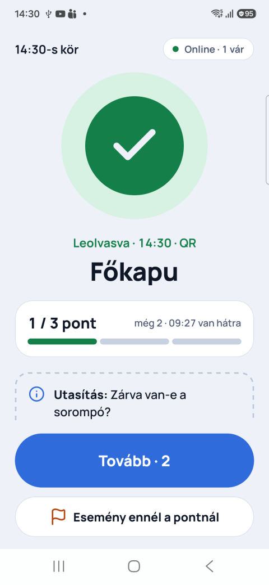
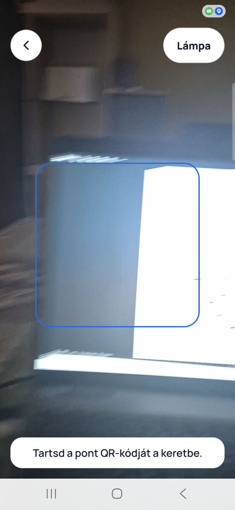

Minden leolvasás után a telefon rezeg és hangot ad, és egy rövid képernyő mutatja az eredményt:

| Eredmény | Mit látsz | Mi a teendő |
| --- | --- | --- |
| **Sikeres** (zöld) | a pont neve, *Leolvasva · 14:15 · QR*, a haladás (*1 / 3 pont*), és ha van, a supervisor utasítása | hajtsd végre az utasítást; a képernyő néhány másodperc múlva magától eltűnik (**Tovább**) |
| **Már leolvasva** | *Már leolvasva 14:15-kor* | semmi: ez a pont ebben a körben már megvan, új leolvasás nem keletkezett |
| **Rossz sorrend** (kötött sorrendnél) | *Leolvastad: Kazánház · Következő lett volna: Raktár hátsó ajtó* | koppints az **Értem, tovább** gombra; a kihagyott pontot ezután is leolvashatod, de az eltérés a jelentésben látszik |
| **Ismeretlen címke** | *Ez a címke nem tartozik ehhez az útvonalhoz* | keresd meg a pont saját címkéjét (**Újra próbálom**); ha az sérült, válaszd a **Sérült címke – kézi rögzítés** lehetőséget |
| **Körön kívül** | *Ez a pont most egyik nyitott körhöz sem tartozik* | semmi: a leolvasás körön kívüliként rögzült, a kört nem befolyásolja |

> **Példa a sorrendre:** az *Éjszakai kör* kötött sorrendje Főkapu → Raktár hátsó ajtó → Kazánház. Ha a Főkapu után a Kazánházat olvasod le, a telefon *Rossz sorrend* jelzést ad. A leolvasás rögzül, a Raktár hátsó ajtót ezután is leolvashatod. A kör így is teljesítve lehet, a jelentés pedig megjelöli a sorrendeltérést.

### 3.7 Kézi rögzítés: ha a címke nem olvasható

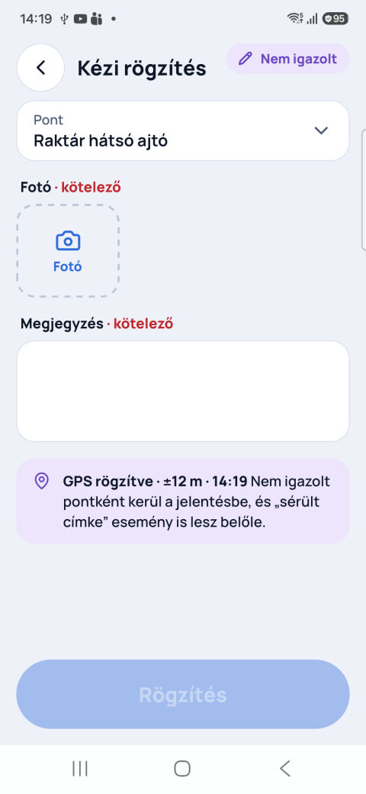
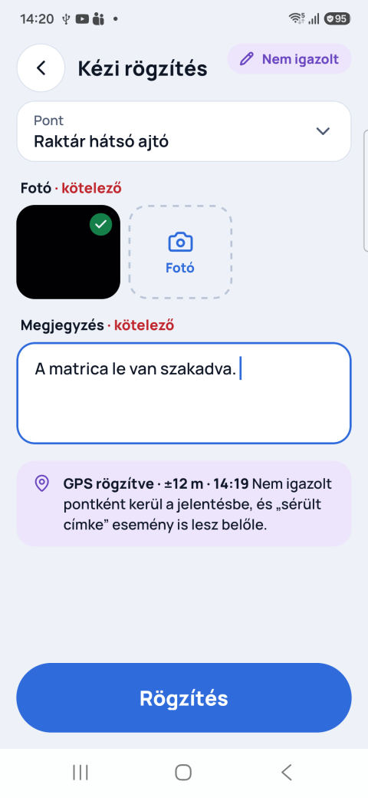
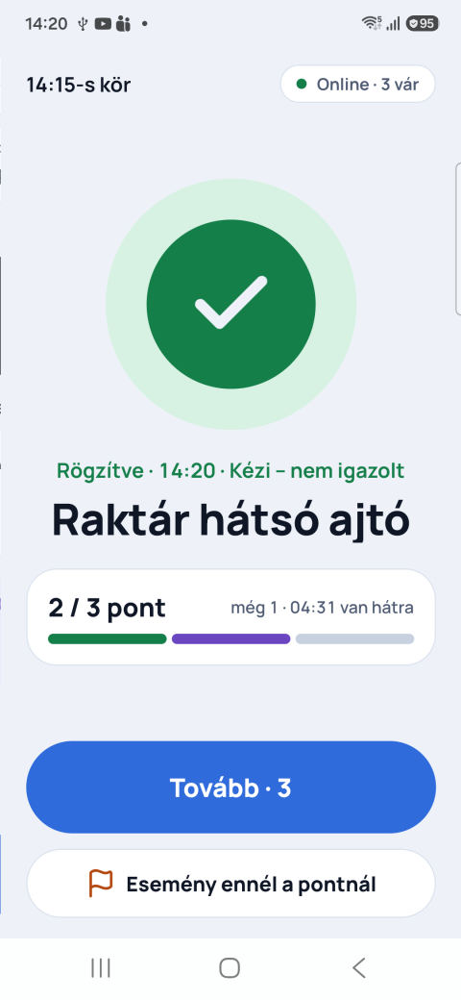

Ha egy pont címkéje leszakadt vagy megsérült, és a QR-tartalék sem olvasható:

1. A kör képernyőjén koppints a **Címke nem olvasható** gombra.
2. **Pont**: válaszd ki, melyik pontnál vagy.
3. **Fotó**: fényképezd le a pontot vagy a sérült címkét (kötelező).
4. **Megjegyzés**: írd le röviden, mi történt (kötelező), pl. *A címke le van szakadva, a ragasztó maradt a falon.*
5. Koppints a **Rögzítés** gombra.

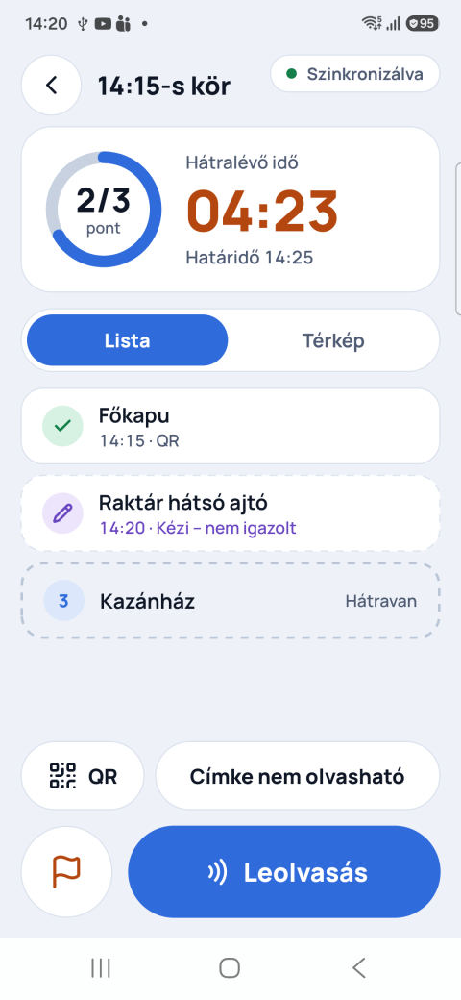
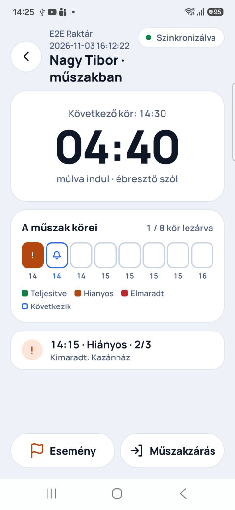

A pont **„Kézi – nem igazolt”** jelöléssel kerül a körbe és a jelentésbe. Ebből a supervisor egy **„Sérült címke”** eseményt is kap, hogy cserélje ki a címkét.

### 3.8 Esemény rögzítése

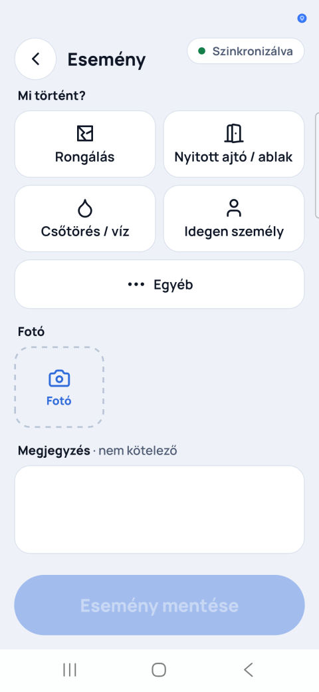
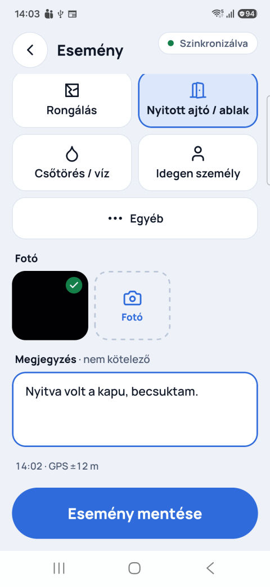
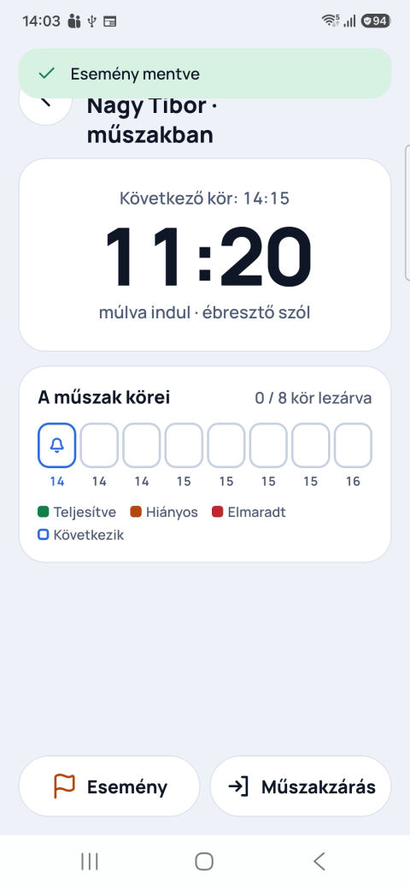

Ha a járőrözés közben valami rendellenességet találsz, rögzítsd eseményként. Eseményt a kezdőlapról (**Esemény**), a kör képernyőjéről (zászló gomb), vagy közvetlenül egy leolvasás után (**Esemény ennél a pontnál**) rögzíthetsz.

1. **Mi történt?** Válassz kategóriát:
   - Rongálás
   - Nyitott ajtó / ablak
   - Csőtörés / víz
   - Idegen személy
   - Egyéb
2. Készíts **fotót**, és írj **megjegyzést**.
3. Koppints az **Esemény mentése** gombra.

Az esemény automatikusan megkapja az időt, a GPS-helyet és a legközelebbi pontot.

> **Példa:** *Nyitott ajtó / ablak* – „A raktár hátsó ajtaja nyitva volt, a zár nem sérült. Bezártam.” + fotó az ajtóról.

Az esemény internet nélkül is mentődik (*„Esemény mentve – feltöltésre vár”*). A supervisor a műszakjelentésben látja.

> Az esemény rögzítése **nem helyettesíti** a riasztást! Vészhelyzetben (betörés, tűz, baleset) előbb hívd a 112-t és a supervisort, és csak utána rögzítsd az eseményt.

### 3.9 Műszakzárás

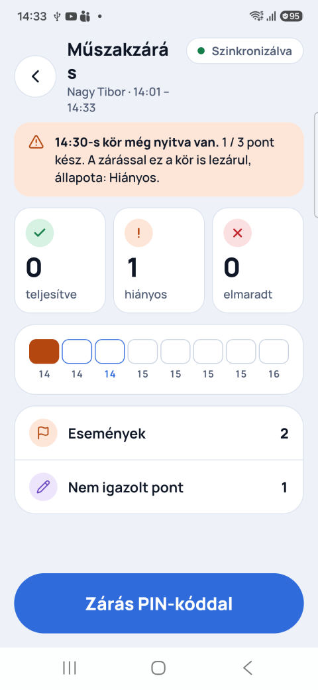

A műszak végén koppints a kezdőlapon a **Műszakzárás** gombra. Az összesítő mutatja:

- hány kör lett **teljesítve**, **hiányos** és **elmaradt**;
- az **eseményeket** és a **nem igazolt** (kézzel rögzített) pontokat;
- ha egy kör még nyitva van, azt is (pl. *„14:30-s kör még nyitva van. 1 / 3 pont kész. A zárással ez a kör is lezárul, állapota: Hiányos.”*).

Koppints a **Zárás PIN-kóddal** gombra, add meg a PIN-kódodat, és erősítsd meg a **Műszak zárása** gombbal. A telefon visszatér a PIN-képernyőre, jöhet a következő őr.

Ha még vannak feltöltésre váró tételek, a jelentés a feltöltés után megy ki a supervisornak, akkor is, ha már zártál. **A telefont ne kapcsold ki**, és hagyd a telephelyen.

Ha a műszak végén elfelejtenéd a zárást, a műszak magától lezárul a nap utolsó körének határideje után 60 perccel. Az időpontot a kezdőlap az utolsó kör után mutatja, például a 20:00–08:00 óránkénti, 5 perces menetrendnél: *„A műszak 09:05-kor automatikusan zárul.”* Ha előbb a következő őr lép be, a váltáskor zárul le.

---

## 4. Gyakori kérdések, hibaelhárítás

**Nem szólt az ébresztő.**
A supervisor nyissa meg a telephelyi telefonon a **Telefon beállítása** képernyőt ([2.10](#210-telefon-beállítása)), és javítsa a piros sorokat. Androidon a leggyakoribb ok, hogy az akkumulátorkímélés nincs kikapcsolva vagy a pontos riasztás nincs engedélyezve. A telefon hangereje se legyen nullán.

**A telefon nem olvassa a címkét.**
- Ellenőrizd, hogy be van-e kapcsolva az NFC (a **Leolvasás** gomb bekapcsolja).
- A telefon **hátának közepét** érintsd a címkéhez, és tartsd ott egy másodpercig. A tok, a fém felület vagy egy mágneses tartó gyengítheti a jelet.
- Ha a pontnál van QR-tartalék, használd a **QR** gombot.
- Ha egyik sem megy: **Címke nem olvasható** ([3.7](#37-kézi-rögzítés-ha-a-címke-nem-olvasható)).

**„Szinkronhiba · újra” látszik.**
A telefon magától újrapróbálja, adat nem vész el. Ha tartósan fennmarad, ellenőrizd az internetkapcsolatot (mobilnet, Wi-Fi). Ha a szinkron részleteiben *„A szerver nem fogadta el a telefon azonosítását”* áll, szólj a supervisornak.

**„Offline · 12 vár” – baj ez?**
Nem: minden működik tovább, a tételek a kapcsolat visszatérésekor feltöltődnek. Ha viszont órákig így marad, a supervisor figyelmeztető e-mailt kap.

**„A telephely adatai még nem érkeztek meg erre a telefonra.”**
A frissen hozzárendelt telefonnak egyszer szinkronizálnia kell. Kapcsold be az internetet, és várj, amíg a jelző *Szinkronizálva* lesz.

**Az őr elfelejtette a PIN-kódját.**
A supervisor az **Őrök és PIN-kódok** képernyőn **Új PIN-kódot** generál neki ([2.4](#24-őrök-és-pin-kódok)). A régi kódot nem lehet visszanézni.

**„Túl sok hibás PIN-kód. Újra próbálhatod … múlva.”**
Várd meg a zárolás végét; a telefon újraindítása nem segít. Ha sürgős, a supervisor a saját PIN-kódjával sem tud belépni, amíg a zárolás tart, ezért gépelj óvatosan.

**„Lépj be újra” üzenet a supervisor telefonján.**
A belépésed lejárt. Lépj be újra: a még el nem küldött módosításaid megmaradnak, és utána felkerülnek.

**„Ezt a telefont egy másik váltotta fel a telephelyen.”**
A telephelyhez új telefont rendeltek. Ez a telefon még feltölti a maradék adatait, utána már nem használható a telephelyen.

**Hol látom a hibákat, ha a támogatás kéri?**
Fiókmenü → **Telefon beállítása** → **Hibanapló**: az utolsó 50 háttérhiba, időponttal.
